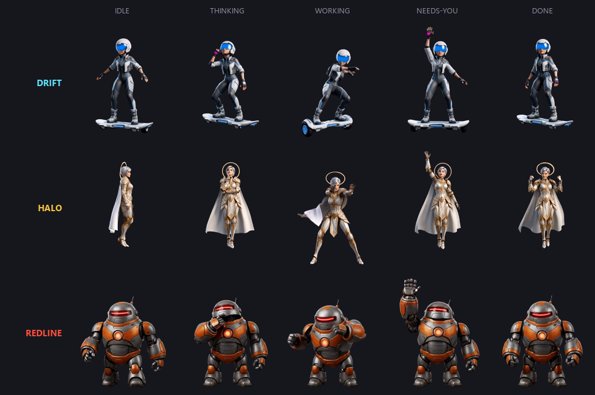

# Claude Code Companion

An animated character that lives on your desktop and reacts to what [Claude Code](https://docs.claude.com/en/docs/claude-code/overview) is doing. It thinks while Claude thinks, works while Claude edits, waves at you when Claude needs an answer, and when a task is done it pulls a signature move right across your chat.



> Unofficial community project. Not affiliated with or endorsed by Anthropic.

## What it does

- **Reacts live** through Claude Code hooks: `idle`, `thinking`, `working`, `needs-you` (permission prompts and questions, with a soft chime) and `done`.
- **Roams the whole screen** on a transparent, click-through layer. You can drag it anywhere and it stays there; double-click to let it roam again.
- **Gets out of the way:** switch windows or browser tabs and it shrinks into the bottom-right corner.
- **Click it** for a ring menu: **Minimize / Restore**, **its signature move**, **Close**.
- **Chat moves:** when a task finishes (or from the ring menu), the character performs over your Claude terminal:
  - **DRIFT** carves across the chat on her hoverboard; the letters in her wake are kicked up and tumble down.
  - **HALO** rises through the window; nearby letters float up glowing gold.
  - **REDLINE** sweeps a red laser down the window; letters crumble into embers.

  Then every letter flies back into place. It's a visual trick over a snapshot of the window, so your real terminal is never touched. It only runs when a Claude Code tab is the window in front, never over other apps or tabs.

## Characters

| Team id | Character | Signature move |
|---|---|---|
| `drift` | DRIFT, a courier on a hoverboard | carve |
| `halo` | HALO, the golden guardian | lift |
| `redline` | REDLINE, the red-visor robot | laser scan |

Pick one per Claude Code session with the `CLAUDE_TEAM` environment variable. Without it you get a glowing orb.

## Install

Requires **Windows 10/11** and **Node.js 20+**.

```sh
git clone https://github.com/KRISH-exe-29/claude-code-companion
cd claude-code-companion
npm install
npm run hooks:install      # adds the hooks to ~/.claude/settings.json (a backup is written first)
npm start                  # starts the companion
```

Then start Claude Code with a character:

```powershell
# PowerShell
$env:CLAUDE_TEAM = "drift"; claude
```

```sh
# Git Bash
CLAUDE_TEAM=drift claude
```

Tip: wrap it in a shell function (`drift`, `halo`, `redline`) that sets `CLAUDE_TEAM`, starts the companion and runs `claude`. With several sessions open, the companion shows whichever one acted last, and a session waiting for you always wins.

Try it without Claude: `npm run demo -- halo` plays a sample session.

## Privacy

Everything stays on your machine. The hook posts a small, whitelisted summary of each event (event name, session id, tool name, file name, notification type) to `127.0.0.1:7777`. The local server rejects browser requests and anything that isn't JSON. Claude Code never waits on the companion: if it isn't running, the hook exits in about a second.

## Add your own character

Each character is a folder in `assets/<team>/`:

- `character.png`: a transparent still (used until clips exist)
- `<mood>.webm`: optional transparent VP9 clips (`idle`, `thinking`, `working`, `needs-you`, `done`). A missing mood falls back to `idle.webm`.

Then add the team to `TEAMS` in `src/state.js` and `src/renderer.js`.

The bundled clips were made with Google Flow (Veo, image-to-video) from start frames on a flat `#00FF00` background, then keyed to transparency:

```sh
python flow/key.py      # flow/raw/<team>-<mood>.mp4  ->  assets/<team>/<mood>.webm
```

Prompts are in `flow/prompts.json` and start frames in `flow/inputs/`. `flow/preview.html` shows every clip side by side.

## Uninstall

```sh
npm run hooks:uninstall
```

## Limitations

- Windows only for now: auto-parking and chat moves use Win32 window APIs. The overlay itself is plain Electron, so ports are welcome.
- Primary monitor only.
- The chat move is skipped when your OS asks apps to reduce motion.

## Development

```sh
npm test                               # node:test, no extra dependencies
node scripts/snap.js halo out/         # render each mood to PNG (offscreen)
```

## License

MIT. The DRIFT, HALO and REDLINE characters and their clips are original works released under the same license.
