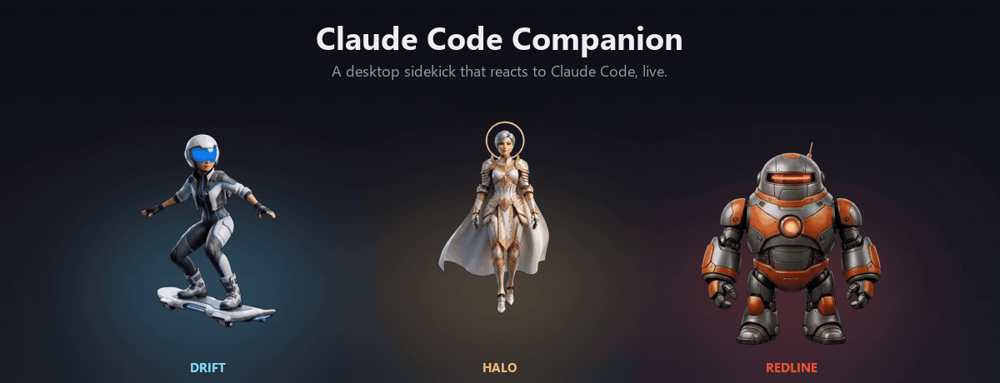
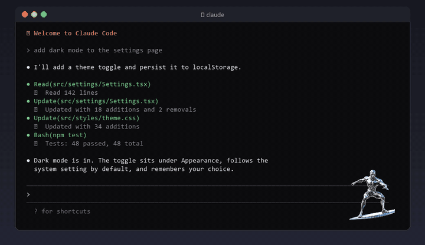
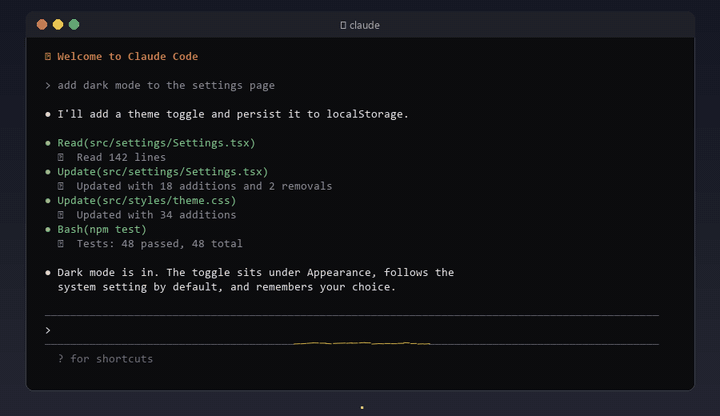
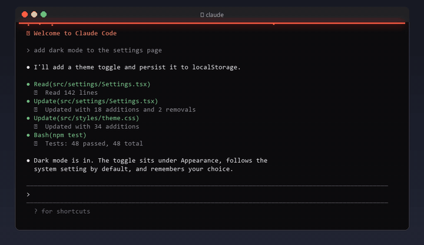
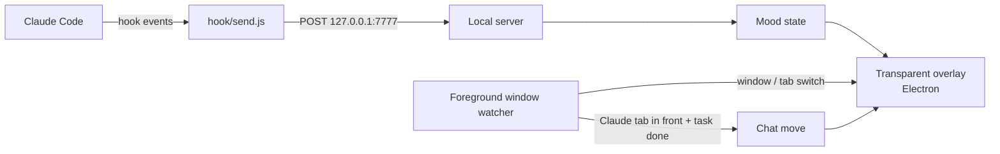

<div align="center">



# Claude Code Companion · Marvel Fan Edition

**Silver Surfer, Sentry and Ultron live on your desktop and react to [Claude Code](https://docs.claude.com/en/docs/claude-code/overview).**<br>
They think while Claude thinks, work while Claude edits, wave when Claude needs you,<br>
and when a task is done they pull a signature move right across your terminal.

[](LICENSE)
[](#disclaimer)
[](#install)
[](https://www.electronjs.org/)
[](https://docs.claude.com/en/docs/claude-code/hooks)
[](https://github.com/KRISH-exe-29/claude-code-companion/stargazers)

[Install](#install) · [Chat moves](#chat-moves) · [The squad](#meet-the-squad) · [How it works](#how-it-works) · [Original edition](https://github.com/KRISH-exe-29/claude-code-companion) · [Disclaimer](#disclaimer)

</div>

> [!NOTE]
> This is the **Marvel fan edition** branch. For the original characters (DRIFT, HALO, REDLINE), see the [`main` branch](https://github.com/KRISH-exe-29/claude-code-companion).

---

## Why

Claude Code works in the background while you do something else. The companion turns that invisible work into something you can see at a glance: a hero on your desktop that shows **what Claude is doing right now** and **taps you on the shoulder** the moment it needs an answer.

## Chat moves

When a task finishes, the on-duty hero performs over your Claude Code terminal. Letters are knocked loose, then every one flies back into place.

<table>
<tr>
<td width="33%" align="center"><br><b>SILVER SURFER</b> surfs across the chat;<br>letters in his wake tumble down.</td>
<td width="33%" align="center"><br><b>SENTRY</b> rises through the window;<br>letters float up glowing gold.</td>
<td width="33%" align="center"><br><b>ULTRON</b> sweeps a red laser down;<br>letters crumble into embers.</td>
</tr>
</table>

<sub>Full-quality videos: <a href="docs/media/chat-surfer.mp4">Silver Surfer</a> · <a href="docs/media/chat-sentry.mp4">Sentry</a> · <a href="docs/media/chat-ultron.mp4">Ultron</a></sub>

It's a visual trick over a snapshot of the window: your real terminal is never touched. It only runs when a Claude Code tab is the window in front, never over other apps or tabs, and it respects your OS "reduce motion" setting. Trigger it any time from the ring menu.

## Features

| | |
|---|---|
| 🎭 **Five live moods** | `idle`, `thinking`, `working`, `needs-you`, `done`, driven by Claude Code hooks |
| 🔔 **Never miss a prompt** | Permission requests and questions switch to `needs-you` with a soft chime |
| 🖥️ **Roams your screen** | Transparent, click-through overlay. Drag it anywhere; double-click to let it roam again |
| 🫥 **Gets out of the way** | Switch windows or browser tabs and it tucks itself into the corner |
| ⭕ **Ring menu** | Click the hero: Minimize / Restore, its signature move, Close |
| 🪄 **Chat moves** | A per-hero effect over your terminal when a task is done |
| 🧑‍🤝‍🧑 **Several sessions** | Shows whichever session acted last; a session waiting for you always wins |
| 🔒 **Local only** | Talks to `127.0.0.1` only. Nothing leaves your machine |

## Meet the squad

<div align="center">

</div>

| Team id | Hero | Signature move | Suggested use |
|---|---|---|---|
| `surfer` | **SILVER SURFER** | surf | builds and features |
| `sentry` | **SENTRY** | golden lift | quick everyday tasks |
| `ultron` | **ULTRON** | laser scan | deep reasoning, hard debugging |

Pick one per session with the `CLAUDE_TEAM` environment variable. Without it you get a glowing orb.

## Install

Requires **Windows 10/11** and **Node.js 20+**.

```sh
git clone -b marvel-edition https://github.com/KRISH-exe-29/claude-code-companion claude-code-companion-marvel
cd claude-code-companion-marvel
npm install
node scripts/install-hooks.js   # adds the hooks to ~/.claude/settings.json (backup: settings.json.companion-bak)
npm start                       # starts the companion
```

Then start Claude Code with a hero:

```powershell
# PowerShell
$env:CLAUDE_TEAM = "surfer"; claude
```

```sh
# Git Bash
CLAUDE_TEAM=ultron claude
```

> **Tip:** wrap it in shell functions (`surfer`, `sentry`, `ultron`) that set `CLAUDE_TEAM`, start the companion and run `claude`.

Try it without Claude: `npm start`, then `node scripts/demo.js sentry` plays a sample session.

Tray icon (right-click): **Mute chime**, **Hide/Show**, **Quit**.

## How it works



1. `node scripts/install-hooks.js` registers a tiny hook for `SessionStart`, `UserPromptSubmit`, `PreToolUse`, `PostToolUse`, `Notification`, `Stop` and `SessionEnd`.
2. Each hook posts a whitelisted summary (event, tool name, file name) to the companion on `127.0.0.1:7777`.
3. The companion maps events to a mood and plays that mood's transparent clip.
4. A foreground-window watcher parks the hero when you switch windows, and lets the chat move run only over a Claude Code tab.

## Privacy

Listens on `127.0.0.1:7777` only. The hook sends the event type, tool name and file name, never prompts, commands or file contents. Nothing is logged.

## Change a hero

- Still image: replace `assets/<team>/character.png` (transparent PNG, portrait).
- Clips: `assets/<team>/<mood>.webm`, transparent VP9, one per mood. A missing mood falls back to `idle.webm`.
- Preview without Claude: `npx electron scripts/snap.js <team> snaps` writes one PNG per mood.

The clips were generated with Google Flow (Veo 3.1 Fast, image-to-video) from start frames on flat `#00FF00`, then keyed:

```sh
python flow/key.py      # flow/raw/<team>-<mood>.mp4  ->  assets/<team>/<mood>.webm
```

## Uninstall

```sh
node scripts/install-hooks.js --uninstall
```

## Development

```sh
npm test
```

## Disclaimer

**Non-commercial fan art.** The Silver Surfer, Sentry and Ultron look-alike characters on this branch were AI-generated as a tribute. Marvel and these character names are trademarks of Marvel / Disney. This project is not affiliated with or endorsed by Marvel, Disney or Anthropic. The code is MIT-licensed; the fan-art images and clips are **not** covered by the MIT license and are shared for personal, non-commercial use only. Rights holders: open an issue and they will be removed.

"Claude" and "Claude Code" are trademarks of Anthropic.

---

<div align="center">

If the squad made you smile, a ⭐ helps other Claude Code users find it.<br>
Want characters you can freely reuse? Try the [original edition](https://github.com/KRISH-exe-29/claude-code-companion).

</div>
