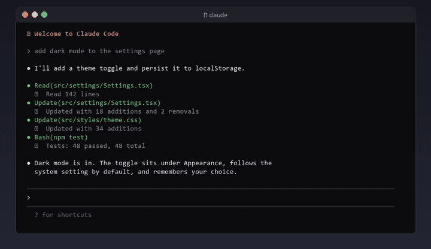
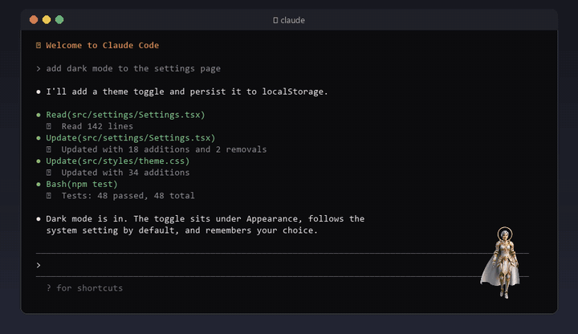
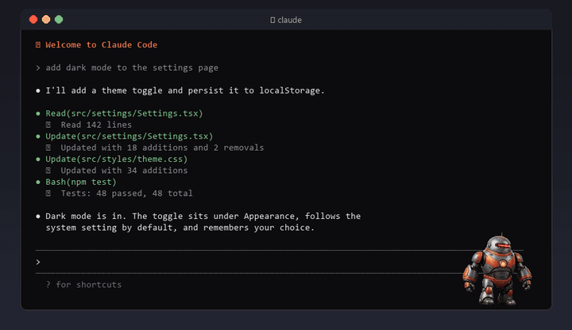
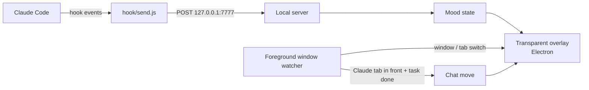

<div align="center">


# Claude Code Companion

**An animated desktop pet for [Claude Code](https://docs.claude.com/en/docs/claude-code/overview).**<br>
It thinks while Claude thinks, works while Claude edits, waves when Claude needs you,<br>
and when a task is done it pulls a signature move right across your terminal.

[](LICENSE)
[](#install)
[](https://www.electronjs.org/)
[](https://nodejs.org/)
[](https://docs.claude.com/en/docs/claude-code/hooks)
[](https://github.com/KRISH-exe-29/claude-code-companion/stargazers)

[Install](#install) · [Chat moves](#chat-moves) · [Characters](#meet-the-crew) · [How it works](#how-it-works) · [Make your own](#make-your-own-character) · [FAQ](#faq)

</div>

---

## Why

Claude Code works in the background while you do something else. The companion turns that invisible work into something you can see at a glance: a character on your desktop that shows **what Claude is doing right now** and **taps you on the shoulder** the moment it needs an answer. No more checking the terminal every thirty seconds.

## Chat moves

When a task finishes, the on-duty character performs over your Claude Code terminal. Letters are knocked loose, then every one flies back into place.

<table>
<tr>
<td width="33%" align="center"><br><b>DRIFT</b> carves across the chat;<br>letters in her wake tumble down.</td>
<td width="33%" align="center"><br><b>HALO</b> rises through the window;<br>letters float up glowing gold.</td>
<td width="33%" align="center"><br><b>REDLINE</b> sweeps a red laser down;<br>letters crumble into embers.</td>
</tr>
</table>

<sub>Full-quality videos: <a href="docs/media/chat-drift.mp4">DRIFT</a> · <a href="docs/media/chat-halo.mp4">HALO</a> · <a href="docs/media/chat-redline.mp4">REDLINE</a></sub>

It's a visual trick over a snapshot of the window: your real terminal is never touched. It only runs when a Claude Code tab is the window in front, never over other apps or tabs, and it respects your OS "reduce motion" setting. Trigger it any time from the ring menu.

## Features

| | |
|---|---|
| 🎭 **Five live moods** | `idle`, `thinking`, `working`, `needs-you`, `done`, driven by Claude Code hooks |
| 🔔 **Never miss a prompt** | Permission requests and questions switch to `needs-you` with a soft chime |
| 🖥️ **Roams your screen** | Transparent, click-through overlay. Drag it anywhere; double-click to let it roam again |
| 🫥 **Gets out of the way** | Switch windows or browser tabs and it tucks itself into the corner |
| ⭕ **Ring menu** | Click the character: Minimize / Restore, its signature move, Close |
| 🪄 **Chat moves** | A per-character effect over your terminal when a task is done |
| 🧑‍🤝‍🧑 **Several sessions** | Shows whichever session acted last; a session waiting for you always wins |
| 🔒 **Local only** | Talks to `127.0.0.1` only. Nothing leaves your machine |

## Meet the crew

<div align="center">

</div>

| Team id | Character | Signature move |
|---|---|---|
| `drift` | **DRIFT**, a courier on a hoverboard | carve |
| `halo` | **HALO**, the golden guardian | lift |
| `redline` | **REDLINE**, the red-visor robot | laser scan |

Pick one per session with the `CLAUDE_TEAM` environment variable. Without it you get a glowing orb.

## Install

Requires **Windows 10/11** and **Node.js 20+**.

```sh
git clone https://github.com/KRISH-exe-29/claude-code-companion
cd claude-code-companion
npm install
npm run hooks:install      # adds the hooks to ~/.claude/settings.json (a backup is written first)
npm start                  # starts the companion
```

Then start Claude Code with a character:

```powershell
# PowerShell
$env:CLAUDE_TEAM = "drift"; claude
```

```sh
# Git Bash
CLAUDE_TEAM=drift claude
```

> **Tip:** wrap it in a shell function (`drift`, `halo`, `redline`) that sets `CLAUDE_TEAM`, starts the companion and runs `claude`.

Try it without Claude: `npm run demo -- halo` plays a sample session.

## How it works



1. `npm run hooks:install` registers a tiny hook for `SessionStart`, `UserPromptSubmit`, `PreToolUse`, `PostToolUse`, `Notification`, `Stop` and `SessionEnd`.
2. Each hook posts a whitelisted summary (event, session id, tool name, file name, notification type) to the companion on `127.0.0.1:7777`.
3. The companion maps events to a mood and plays that mood's transparent clip.
4. A foreground-window watcher parks the character when you switch windows, and lets the chat move run only over a Claude Code tab.

## Privacy

Everything stays on your machine. The local server rejects browser requests and anything that isn't JSON. Claude Code never waits on the companion: if it isn't running, the hook exits in about a second.

## Make your own character

Each character is a folder in `assets/<team>/`:

- `character.png`: a transparent still (used until clips exist)
- `<mood>.webm`: optional transparent VP9 clips (`idle`, `thinking`, `working`, `needs-you`, `done`). A missing mood falls back to `idle.webm`.

Then add the team to `TEAMS` in `src/state.js` and `src/renderer.js`, and give it a move in `src/chatfx.js`.

The bundled clips were made with Google Flow (Veo, image-to-video) from start frames on a flat `#00FF00` background, then keyed to transparency:

```sh
python flow/key.py      # flow/raw/<team>-<mood>.mp4  ->  assets/<team>/<mood>.webm
```

Prompts are in `flow/prompts.json` and start frames in `flow/inputs/`. `flow/preview.html` shows every clip side by side. Made a character? Open a PR and share it.

## FAQ

<details>
<summary><b>Does it slow Claude Code down?</b></summary>

No. Hooks run asynchronously with a short timeout, and the companion only receives small JSON events.
</details>

<details>
<summary><b>Does it read my code or prompts?</b></summary>

No. The hook sends only the event name, session id, tool name, file name and notification type, and only to `127.0.0.1`.
</details>

<details>
<summary><b>macOS or Linux?</b></summary>

Not yet. Auto-parking and chat moves use Win32 window APIs. The overlay itself is plain Electron, so ports are welcome.
</details>

<details>
<summary><b>How do I remove it?</b></summary>

`npm run hooks:uninstall`, then delete the folder.
</details>

## Limitations

- Windows only for now.
- Primary monitor only.
- The chat move is skipped when your OS asks apps to reduce motion.

## Development

```sh
npm test                               # node:test, no extra dependencies
node scripts/snap.js halo out/         # render each mood to PNG (offscreen)
```

## Contributing

Issues and pull requests are welcome: new characters, new chat moves, macOS/Linux support. If the companion made you smile, a ⭐ helps other Claude Code users find it.

## License

MIT. The DRIFT, HALO and REDLINE characters and their clips are original works released under the same license.

> Unofficial community project. Not affiliated with or endorsed by Anthropic. "Claude" and "Claude Code" are trademarks of Anthropic.
